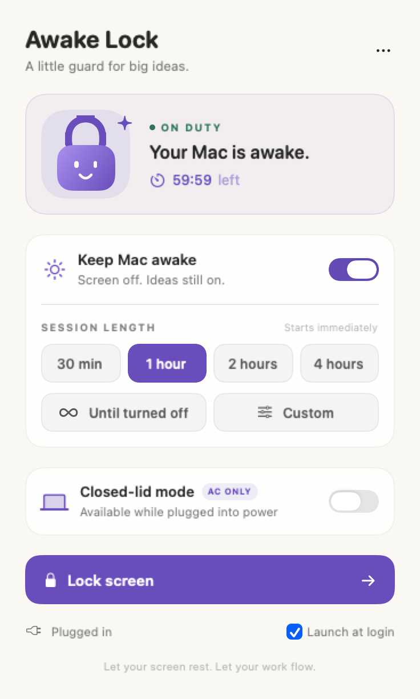
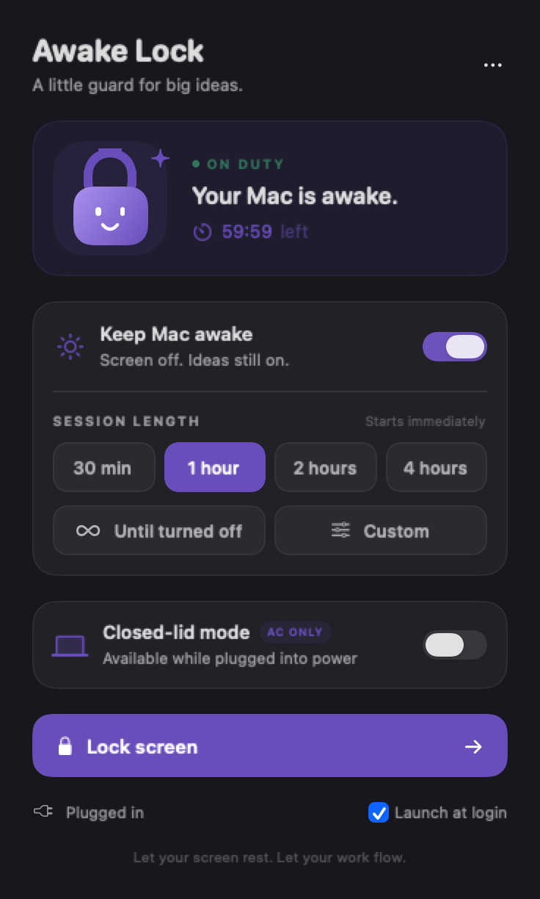

<p align="center">
  
</p>

<h1 align="center">Awake Lock</h1>
<p align="center"><strong>A little guard for big ideas.</strong><br>Let your screen rest. Let your work flow.</p>

Awake Lock is a small native macOS menu-bar app that prevents automatic idle sleep while your work continues. Set a timer, lock your screen, and let your coding agents, terminals, downloads, or other background tasks keep running.

**Early preview · macOS 13+ · Swift / SwiftUI · No third-party dependencies**

<p align="center">
  
  
</p>

## Download

```bash
brew install --cask sayyidsyamil/tap/awake-lock
```

Or grab `Awake-Lock-0.1.0.zip` from the [latest release](https://github.com/sayyidsyamil/awake-lock/releases/latest), unzip it, and move **Awake Lock.app** to `~/Applications`.

Preview builds are ad-hoc signed, not notarized. A zip saved by a browser carries the quarantine flag, so the first launch is blocked; either install with Homebrew, whose cask clears the flag, or allow the app once through **System Settings → Privacy & Security → Open Anyway**. Do not disable Gatekeeper globally.

## Features

- **Timed sessions:** 30 minutes, 1 hour, 2 hours, 4 hours, or a custom duration.
- **Indefinite mode:** stay awake until you turn the session off.
- **Live countdown** and clear On Duty / Off Duty status.
- **Lock screen:** protects access without ending the keep-awake session.
- **Display sleep stays allowed:** your screen can turn off while your Mac works.
- **Optional closed-lid mode:** AC-power-only override with a heartbeat watchdog.
- **Launch at login**, using macOS’s native login-item service.
- **Light and dark appearance**, a custom icon, and a friendly vector mascot.

## Build from source

You need macOS 13 or later and Apple’s Command Line Tools. No Xcode project or package manager is required.

```bash
# Install Apple’s developer tools if you don't already have them:
xcode-select --install

# From a clone or downloaded copy of this repository:
bash scripts/build.sh
bash scripts/install.sh
```

The app is installed at **`~/Applications/Awake Lock.app`**. The build script compiles a universal `arm64` + `x86_64` bundle, applies a signature, and runs the included self-checks.

See [docs/RELEASING.md](docs/RELEASING.md) for signing, notarization, and the release process.

Builds are ad-hoc signed by default. Set `CODESIGN_IDENTITY` to a `Developer ID Application: …` identity to sign for distribution, then run `bash scripts/notarize.sh` to notarize and staple the result.

## How to use

1. Click the small **lock icon** in the menu bar.
2. Choose **1 hour**, another preset, **Custom**, or **Until turned off**. Timer buttons start immediately.
3. Confirm the panel says **ON DUTY**. A filled lock and dot indicate an active native sleep-prevention assertion.
4. Click **Lock screen** if you want to leave your Mac unattended.
5. Turn **Keep Mac awake** off to end a session early.

When the timer expires, Awake Lock releases its sleep-prevention assertion. It **does not force sleep, terminate your work, or override another app’s assertions**. Normal macOS idle-sleep rules resume.

**Can't find the icon?** There may be too many menu-bar items near the notch. Close some menu-bar utilities or hold **⌘ Command** and drag the lock nearer the clock. Its position is remembered. In full-screen apps, move the pointer to the top edge to reveal the menu bar.

## Closed-lid mode — experimental

Ordinary idle-sleep assertions do **not** override MacBook lid-close sleep. This optional feature uses a privileged helper to set **`pmset -a disablesleep 1`** during an eligible session.

1. Install the app in `~/Applications` using the script above.
2. Enable **Closed-lid mode** in the panel.
3. Approve the one-time macOS administrator prompt. Enter your password only in the system dialog.
4. Connect your charger and start a keep-awake session.
5. Wait until the panel shows **Active · charger connected** before closing the lid.

The helper restores the preceding `SleepDisabled` setting when you unplug, disable the mode, end the session, or the app stops renewing its short heartbeat lease. A recovery marker allows restoration after a helper crash or reboot. Detection can take a few seconds; an app crash can take up to approximately 12 seconds to expire the lease.

**This mode disables system sleep globally while active, not just lid-close sleep.** Use a ventilated desk surface, never a closed bag. It cannot guarantee uninterrupted Wi-Fi, prevent application crashes, or survive shutdown. Physical closed-lid behavior still needs validation across Mac models and macOS releases. The helper is single-user: the last user who installs it owns the configuration.

If you move or reinstall the app after enabling the helper, reinstall closed-lid support so the registered executable path stays current. The public preview uses a simple administrator-assisted installer; a signed XPC/ServiceManagement helper is planned for a production release.

## Remove the app

1. Disable **Launch at login** in the panel.
2. Choose **⋯ → Quit Awake Lock**.
3. If you enabled closed-lid support, remove its helper:

   ```bash
   sudo bash scripts/uninstall-helper.sh
   ```

4. Move `~/Applications/Awake Lock.app` to the Trash.
5. Optionally remove preferences with `defaults delete io.awakelock.app` and remove `~/Library/Application Support/Awake Lock`.

If this Mac also has the original local prototype, the prototype and preview share the optional helper. Removing the helper removes closed-lid support for both.

## Verify sleep prevention

```bash
pmset -g assertions
```

An active normal session should list **AwakeLock** with **PreventUserIdleSystemSleep**. Display-sleep prevention is intentionally not requested.

```bash
"build/Awake Lock.app/Contents/MacOS/AwakeLock" --self-test
"build/Awake Lock.app/Contents/Resources/awake-lock-helper" --self-test
```

These checks cover native assertion creation/release, timer expiry, indefinite mode, charger gating, lease expiry, and helper eligibility. They do not physically close a laptop lid or validate every supported Mac.

## Project layout

```text
Sources/main.swift       App lifecycle, native assertions, timer, login item
Sources/Panel.swift      SwiftUI panel and vector lock mascot
Sources/helper.swift     Optional privileged closed-lid watchdog
Resources/               App metadata and multi-resolution icon
scripts/                 Build, install, helper removal, icon generator
docs/                    Screenshots and brand/design notes
```

## Privacy

Awake Lock includes no analytics, accounts, remote services, or network requests. Preferences and helper heartbeat files stay on your Mac. It keeps the system awake; it does not inspect your AI prompts or app content.

## Release roadmap

- Developer ID signing and Apple notarization; the pipeline is in place and only needs a certificate.
- Signed helper installation and authenticated IPC.
- Physical charger/lid/crash/reboot testing across MacBook models.
- Packaged uninstall and helper-repair interface.

Contributions and reproducible bug reports are welcome. Please include your macOS version, Mac model, power source, and steps to reproduce—never passwords, tokens, or private AI prompts.

## License

MIT. See [LICENSE](LICENSE).
